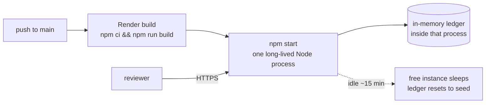

# Deployment — why Render, and what was rejected

The app must be hosted somewhere that **executes server code**. Every page is
server-rendered on demand and the entire API is Next.js route handlers; that is
a deliberate constraint of the project, not an accident of the build.

## Rejected: GitHub Pages

Static files only. The only way to target it is `output: "export"`, which was
actually attempted — it fails on the route handlers:

```
Error: export const dynamic = "force-static"/export const revalidate not configured
on route "/api/transactions" with "output: export"
> Build error occurred
Error: Failed to collect page data for /api/transactions/[id]
```

Making it work would mean deleting the API layer and moving amount parsing,
rounding, conversion and the Frankfurter call into the browser. That breaks the
project's central rule — all business logic server-side, money never computed
on the client — which is the thing the code exists to demonstrate. Rejected on
substance, not on effort.

## Rejected (for now): Vercel as-is

Vercel is the natural home for Next.js, and the build deploys there fine. The
problem is this app's storage: the ledger is an in-memory object on
`globalThis`.

On serverless, a request can land on any instance and idle instances are
recycled. `POST /api/deposits` may write to one instance while the dashboard
render that follows reads another — so a reviewer could deposit money and watch
it disappear on the next screen. The README documents "data resets on restart",
but a reviewer would reasonably read this as a bug.

**This is fixable and worth doing**: a persistent `WalletRepository`
implementation (Redis or Postgres) behind the existing interface, which is
precisely the swap the architecture was designed for. It needs the repository
interface to become async, which ripples through the use cases and their tests.
Deferred as a known follow-up, not as a blocker.

## Chosen: Render (free tier)

One long-lived Node process, so the in-memory ledger behaves exactly as it does
locally, with **zero code change**. Verified against a local production build
before choosing it:

- `next start` binds `$PORT` with no `-p` flag — the host sets the port
- `POST /api/deposits` → the next `GET /api/wallets/:id` reflects it
- the server-rendered dashboard HTML reflects it too



### What the reviewer will see

- **First load after idle is slow** (~30–60s) — the free instance cold-starts.
- **State is consistent while awake**: deposits, transfers and conversions all
  stick and agree across pages.
- **The ledger resets to its seeded state after a sleep.** This is the same
  documented limitation as a local restart, now simply triggered by idling.

Railway is an equivalent choice (also a long-lived process) and needs no
blueprint file — it auto-detects Next.js. `render.yaml` is committed because
Render can create the whole service from it in one step.
