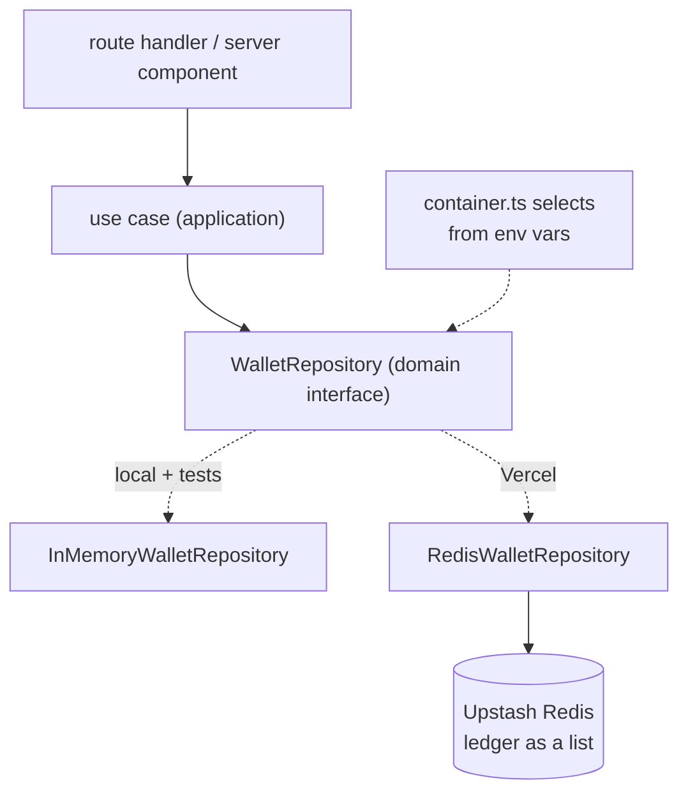

# Deployment — Vercel, with the ledger in Redis

## Why the storage decides the host

The app must run server code: every page is rendered on demand and the whole
API is route handlers. That ruled out one option immediately, and made the
other conditional.

**GitHub Pages — not viable.** Static files only. The only route to it is
`output: "export"`, which was attempted rather than assumed:

```
Error: export const dynamic = "force-static"/export const revalidate not configured
on route "/api/transactions" with "output: export"
> Build error occurred
```

All nine route handlers fail. Serving it statically would mean moving amount
parsing, rounding, conversion and the Frankfurter call into the browser —
breaking the rule the project exists to demonstrate.

**Vercel — needed persistence first.** Serverless gives no instance affinity
and recycles idle instances. With the ledger on `globalThis`, `POST
/api/deposits` could write to one instance while the dashboard render that
follows reads another, and a deposit would appear to vanish.

**Render was chosen briefly** because one long-lived process makes the
in-memory ledger behave correctly with zero code change. It works, but it is
the host compensating for a storage decision. Persisting the ledger is the
better fix, and it makes the app host-agnostic.

## What changed

The ledger moved into Redis, behind the interface that already existed:



Nothing in `domain/` or `application/` knows Redis exists. The adapter is
chosen in `container.ts` alone, which is the payoff the layering was for.

**The one unavoidable ripple:** `WalletRepository` was synchronous. A
network-backed store cannot be, so every method returns a `Promise` and that
propagated through the use cases, the route handlers, the server components and
their tests.

**Storage model.** The ledger is a Redis list (`wallet:ledger`): `RPUSH` to
append, `LRANGE 0 -1` to read. Append-only falls out of the data structure.
Opening deposits are written once, guarded by `SET wallet:seeded:v1 NX`, so
concurrent cold starts cannot each seed their own copy and conjure money.

The wallet set itself stays in code — it is fixed configuration, not state.

## Deploying to Vercel

1. **Create the Redis store.** Vercel dashboard → **Storage** → **Create
   Database** → **Upstash Redis** (free tier) → connect it to this project.
   Vercel injects `KV_REST_API_URL` and `KV_REST_API_TOKEN` automatically.
2. **Import the repo.** **Add New** → **Project** → pick the repository.
   Next.js is detected; no build settings to change.
3. **Deploy.** Subsequent pushes to `main` deploy automatically.

A direct Upstash account works too — the container accepts
`UPSTASH_REDIS_REST_URL` / `UPSTASH_REDIS_REST_TOKEN` as well.

**Configuration lives in one place.** Every variable the code reads is declared
in the committed `.env.example`; real values go in `.env.local`, which is
gitignored. `.env.local` rather than `.env` because `vercel env pull` writes
that exact filename by default, so pulling the live configuration down does not
leave two files that disagree. The variable-by-variable table is in the README
under *Environment variables*.

**There is no silent fallback.** If the app boots on Vercel without Redis
configured it throws, by design: a deploy that looks healthy while quietly
losing every transaction is the worst available outcome. This was confirmed by
running it rather than reasoning about it — `VERCEL=1 npm run build` with no
Redis variables set exits 1 at page-data collection:

```
> Build error occurred
Error: Failed to collect page data for /api/transfers
  [cause]: Error: Running on Vercel without Redis configured. Set
  KV_REST_API_URL and KV_REST_API_TOKEN (or the UPSTASH_REDIS_REST_*
  equivalents): the in-memory ledger cannot survive across serverless instances.
```

Note that the failure arrives at **build** time, not first request, and that
Next's headline names a route instead of the cause — the reason is one line
down under `[cause]`.

Locally, no Redis is needed — with no variables set the in-memory ledger is
used, so `npm run dev` and `npm test` stay dependency-free.

## Known limitation this introduces

**Concurrent writes can still race.** A use case reads the balance, then
appends. With one process that sequence was effectively atomic; across
serverless instances it is not, so two simultaneous withdrawals could both pass
the funds check and overdraw a wallet. The window is small and the re-check
before the append in `convertCurrency` narrows it further, but it is real.

The honest fix is a per-wallet lock (`SET NX PX` with a token) or a Lua script
that validates and appends atomically. Deliberately not done here: it is a
meaningful piece of work and this is a demonstration app with one simulated
user. Recorded as the next thing worth building, not glossed over.
